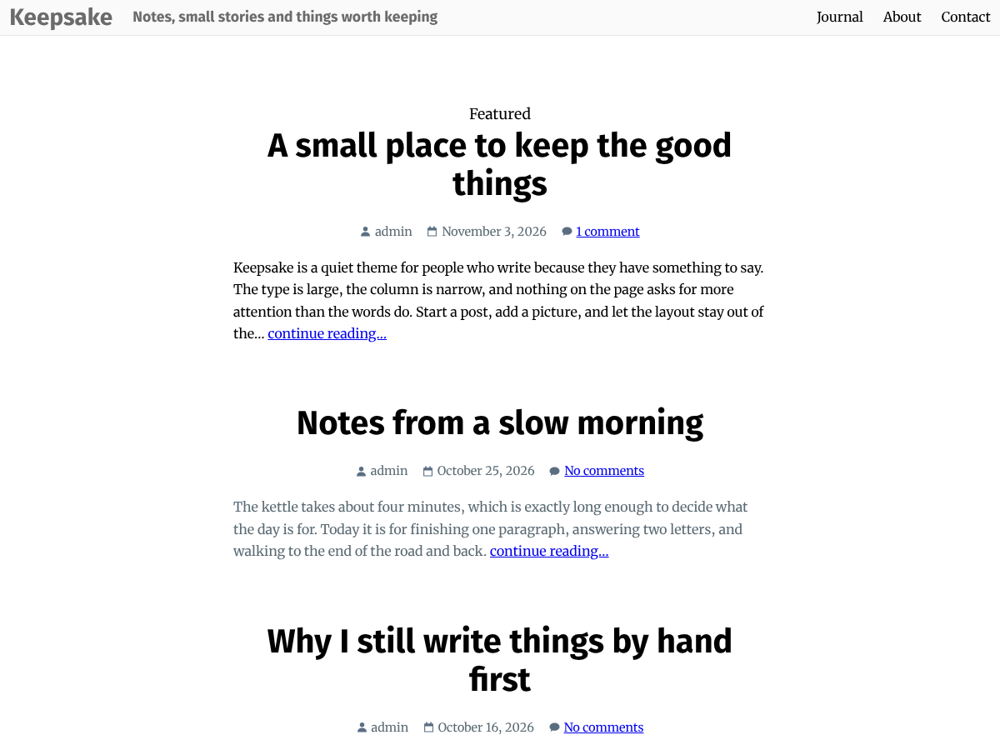

# Keepsake

A quiet block theme for blogs and portfolios. Large type, a narrow reading column, and nothing on the page that asks for more attention than your words.



## Features

- **Block theme.** Built with `theme.json`, HTML block templates and template parts. Colors, typography, spacing and layout are all editable in the Site Editor (Appearance > Editor > Styles).
- **Reading-first layout.** 640px content column, 1170px wide width, and support for wide and full-width blocks. Featured images can be set to wide or full width.
- **Bundled fonts.** Merriweather for text and Fira Sans for headings, served from the theme. Nothing is loaded from other websites.
- **Sticky posts** get a "Featured" label on the post list.
- **Styled comments** with cards, round avatars, a threaded reply line and a restyled comment form.
- **Accessible by default.** Visible keyboard focus styles, text contrast of at least 4.5:1, and a skip link added by WordPress.
- **Translation ready** with a text domain and a `.pot` file.
- **No build step and no dependencies.** No Composer, npm or plugins required.

### Templates

| Template | Used for |
| --- | --- |
| `index` | Blog home and fallback |
| `single` | Single posts, with comments |
| `page` | Pages |
| `archive` | Category, tag, author and date archives |
| `search` | Search results |
| `404` | Not found |
| `home-page` | Optional "Home" page template |

The header and footer are template parts you can edit in the Site Editor.

## Requirements

- WordPress 6.6 or later
- PHP 7.4 or later

## Installation

1. Download the theme as a zip, or copy the `keepsake` folder to `wp-content/themes/`.
2. In WordPress, go to **Appearance > Themes** and activate **Keepsake**.
3. Open **Appearance > Editor** to adjust the header, footer, menu and styles.

## Customizing

- **Colors, fonts, spacing:** Appearance > Editor > Styles. Defaults live in `theme.json`.
- **Menu:** select the Navigation block in the header and build your own menu. Until you do, it lists your pages and their sub-pages, and nested menus open as dropdowns.
- **Author name:** the Post Author block does not link to the author archive by default. Turn on "Link to author archive" in the block settings if you run a multi-author site.

## Project structure

```
keepsake/
├── style.css          Theme header and the few styles theme.json can't express
├── theme.json         Settings, palette, typography, layout and block styles
├── functions.php      Theme support, image sizes, stylesheet, text domain
├── templates/         Block templates (index, single, page, archive, search, 404, home-page)
├── parts/             Template parts (header, footer)
├── assets/fonts/      Merriweather and Fira Sans (woff2) with their licenses
├── languages/         keepsake.pot
├── screenshot.png     1200 x 900 theme screenshot
├── readme.txt         WordPress.org readme
└── changelog.md
```

## Development

There is no build step. Edit the files and reload your test site.

- Work on branches and open pull requests against `develop`.
- Check block templates after editing: every `<!-- wp:... -->` needs a matching closing comment.
- Before a release, run the [Theme Check](https://wordpress.org/plugins/theme-check/) plugin on a test site.
- To package the theme for upload, zip the folder without hidden files, for example from the parent directory:

  ```
  zip -r keepsake.zip keepsake -x "*/.*" -x "keepsake/readme.md" -x "keepsake/changelog.md"
  ```

  WordPress.org requires that the upload contains no hidden files such as `.git` or `.editorconfig`.

## Credits and licenses

- Keepsake is licensed under the [GNU General Public License v2 or later](https://www.gnu.org/licenses/gpl-2.0.html). (C) 2018-2026 Benjamin Lu.
- [Merriweather](https://github.com/SorkinType/Merriweather), (C) 2016 The Merriweather Project Authors, [SIL Open Font License 1.1](assets/fonts/OFL-Merriweather.txt).
- [Fira Sans](https://github.com/bBoxType/FiraSans), (C) 2012-2018 The Mozilla Foundation, Telefonica S.A., Carrois Corporate GbR and bBox Type GmbH, [SIL Open Font License 1.1](assets/fonts/OFL-FiraSans.txt).
- `screenshot.png` and the meta-row icons were created by the theme author for this theme.
